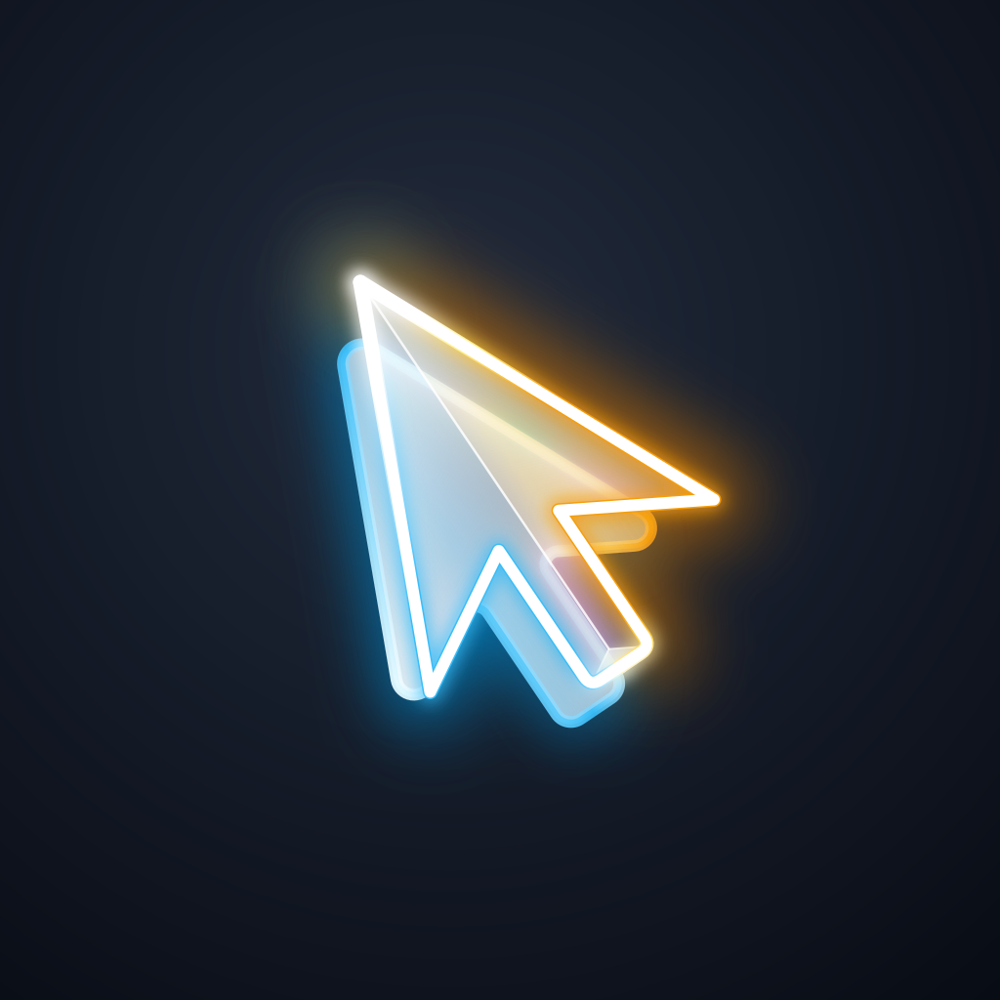

<div align="center">



# Solstein

**Turn your phone into a zero-driver Bluetooth HID trackpad**

[%20%7C%20iOS%20(v2)-blue.svg?style=flat-square)](#)
[](#)
[](#)
[](#)

*Named after sólarsteinn — the Viking optical sunstone.*

</div>

---

## Overview

Solstein emulates a real Bluetooth HID device: your computer (Mac, Windows, or Linux) pairs with it like ordinary hardware — with **zero software to install on the computer**. 

- **Zero-Driver, Zero-Configuration**: Works from the OS login screen, completely offline, with no helper app required on the host.
- **Hardware-Level Emulation**: Emulates a standard Bluetooth mouse and trackpad over standard BLE HID profiles.
- **Two-Tier Architecture**: Native standalone mode works out of the box; an optional lightweight desktop helper unlocks iOS clients and rich multi-finger gestures.

---

## Brand Identity: The Double-Refraction Pointer & The Hidden Sól (ᛋ)

<div align="center">
  
</div>

The official brand identity for Solstein is **The Double-Refraction Cursor** (Concept #2):

- **The Viking Sunstone (*Sólarsteinn*)**: Norse navigators used Iceland spar optical calcite crystals to pinpoint the sun through overcast skies and sea fog. Calcite exhibits *birefringence* (double refraction), splitting light rays into twin polarized paths.
- **The Birefringent Ghost Pointer**: The primary calcite crystal cursor casts an offset, semi-translucent twin ghost shadow beneath it. Just as Norse voyagers rotated the sunstone until the twin images reached equal brightness to find true solar azimuth, the dual pointer represents locating and guiding your screen coordinate across invisible radio waves.
- **The Hidden Younger Futhark Sól (`ᛋ`) Rune**: Rather than forcibly grafting a runic letter onto software iconography, the geometry of the cursor arrow inherently embeds the rune:
  - **Left Contour**: Traces the exact 3-stroke zigzag of the authentic Younger Futhark Sól (`ᛋ`) rune (tip to left wing tip, sharp inward notch, and downward stem), illuminated in electric Nordic cyan (`#38BDF8`).
  - **Right Contour**: Symmetrically mirrors the rune along the right pointer ridge, glowing with warm solar amber (`#F59E0B`).
- **Prismatic Dispersion & Internal Caustics**: Optical rainbow dispersion (violet to gold) refracted where the ghost pointer shines through the faceted crystal body.
- **Dual Polarization**: Nordic cyan represents the Bluetooth wireless carrier and host screen; solar amber represents the guiding celestial sun.

> 📐 **Master Vector Graphic & App Icon Suite**:
> - **Full-Bleed App Icon**: [docs/assets/icon-fullbleed.svg](docs/assets/icon-fullbleed.svg) · [docs/assets/icon.png](docs/assets/icon.png) (iOS/Android native icon standard)
> - **Presentation Logo**: [docs/assets/logo.svg](docs/assets/logo.svg) (Card-on-canvas branding showcase)
> - **Android Adaptive & Themed Icons**: `app/assets/icon/` (Adaptive foreground, background & Material You monochrome silhouette)
> - **iOS 18 Asset Catalog**: `app/assets/icon/ios/AppIcon.appiconset/` (Xcode 14–16 ready: Standard, Dark mode, and Tinted grayscale)
> - **Interactive Layer Studio**: Open [docs/vector-studio.html](docs/vector-studio.html) to toggle layers, inspect runic vector paths, test adaptive icon masks, and export individual SVG assets.
> - **Design Exploration Archive**: Discover the complete evolution of 33 concept iterations in the [Logo Showcase](docs/logo-showcase.html).


---

## Status

🚧 In active development — see [docs/roadmap.md](docs/roadmap.md) for current milestones.

---

## Repository Layout

```
app/     Flutter client (Android first)
helper/  Flutter desktop helper (v2)        — placeholder
docs/    Architecture, HID spec, protocol, gesture mapping, ADRs, roadmap
```

---

## Documentation

- [Architecture Overview](docs/architecture.md) — System boundaries and lifecycle
- [HID Report Descriptor](docs/hid-descriptor.md) — Standard HID byte format
- [Gesture Mapping](docs/gesture-mapping.md) — The three-tier gesture model
- [Wire Protocol](docs/protocol.md) (v2) — Optional desktop helper packet format
- [Decisions (ADRs)](docs/decisions.md) — Architecture decision records
- [Roadmap](docs/roadmap.md) — Project milestones
- [Logo & Brand Showcase](docs/logo-showcase.html) — Interactive 33-concept visual identity archive

---

## License

MIT License. See `LICENSE` for details.
